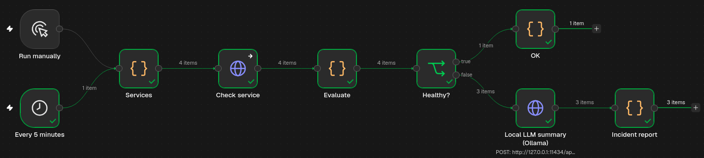

# Local AI Incident Reporter

An n8n workflow that checks my portfolio website (www.omar-radwan.com) and other services every 5 minutes. When a service is down or too slow, a local LLM running in Ollama writes a short incident note: what is wrong, two likely causes, and the first thing to check. Everything runs on your own machine, so no monitoring data goes to a cloud AI service.



## How it works

1. **Trigger**: a schedule (every 5 minutes) or a manual run.
2. **Services**: the list of URLs to watch.
3. **Check service**: an HTTP request per service with a 5 second timeout. Errors and timeouts do not stop the workflow, they become part of the result.
4. **Evaluate**: marks each service as healthy (status 200 to 399) or not.
5. **Healthy?**: healthy services go to the OK path. The rest go to the alert path.
6. **Local LLM summary**: sends the facts of the failed check to Ollama (qwen2.5:3b). The prompt tells the model to use only the given data, so it does not invent server names.
7. **Incident report**: the final note per failed service.

The portfolio and my GitHub profile are real checks. Two more services are broken on purpose (an HTTP 503 and an 8 second delay) so the alert path runs on every test.

## Run it

Requirements: Docker and Ollama with `qwen2.5:3b` pulled.

```
docker run -d --name n8n --network host \
  -e N8N_LISTEN_ADDRESS=127.0.0.1 -e N8N_SECURE_COOKIE=false \
  -e TZ=Europe/Berlin -e GENERIC_TIMEZONE=Europe/Berlin \
  -v n8n_data:/home/node/.n8n docker.n8n.io/n8nio/n8n
```

Open http://localhost:5678, then Workflows, Import from File, and choose `workflow.json`. Click Test workflow.

## Next steps

- Send the incident note to Slack, email or a ticket system.
- Read alerts from Grafana through a webhook instead of polling URLs.
- Measure response time and alert on slow responses, not only on errors.
